# Kulüpler için canlı quiz sistemi

Üniversite kulüplerinin etkinliklerde büyük ekrana yansıtıp yüzlerce kişiyle
telefondan oynayabildiği, açık kaynak ve kendi Firebase projenizde çalışan bir
canlı quiz sistemi.

**Canlı:** <https://cenga-quiz.web.app> (oyuncu girişi) · `/host` (sunucu paneli)

## Ekran görüntüleri

### Sunum ekranı (projeksiyon)

| Lobi: QR ile katılım | Soru |
|---|---|
| 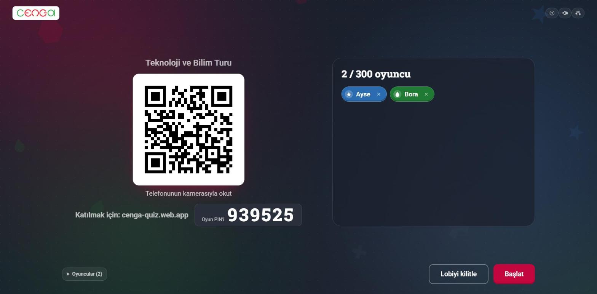 | 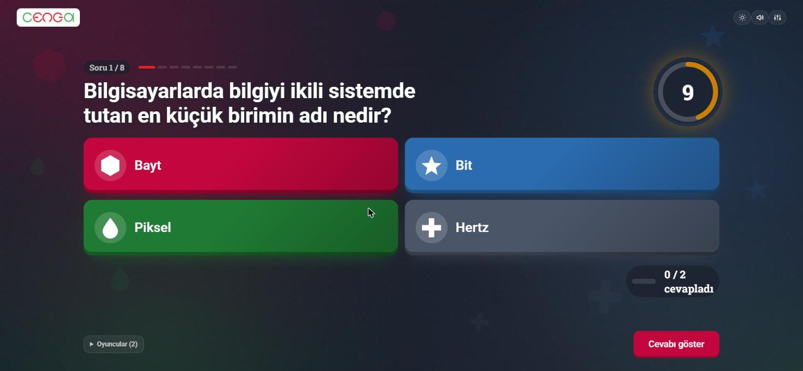 |
| **Cevap gösterimi** | **Sıralama: yer değişimi ve seri** |
| 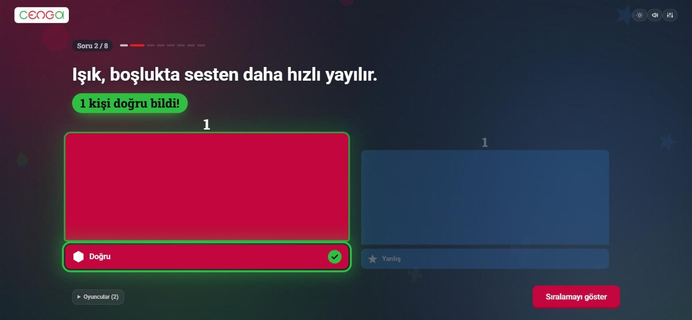 | 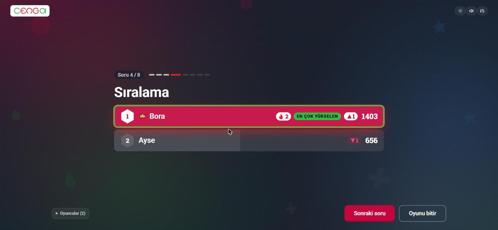 |
| **Son sorularda 2× puan** | **Podyum ve ilk 10** |
| 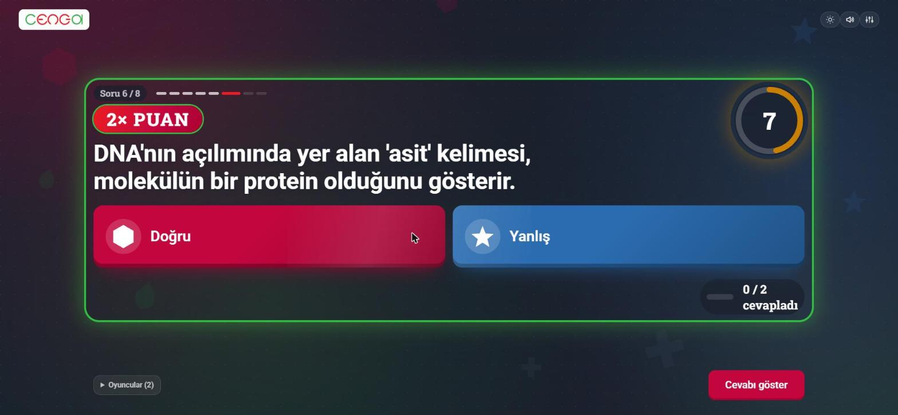 | 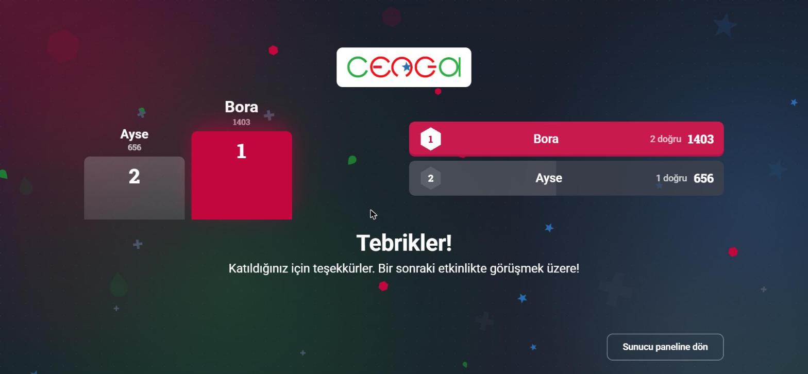 |

### Oyuncu (telefon)

| Katılım | Soru | Doğru cevap | Final |
|---|---|---|---|
| 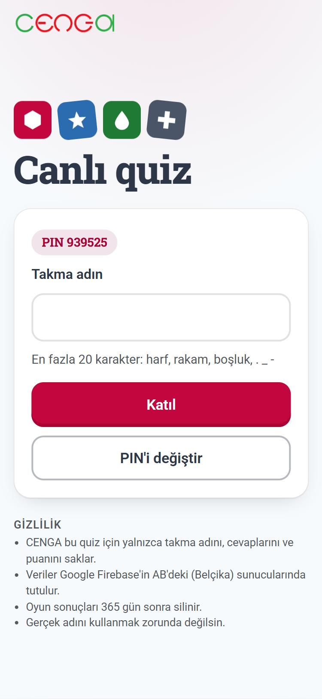 | 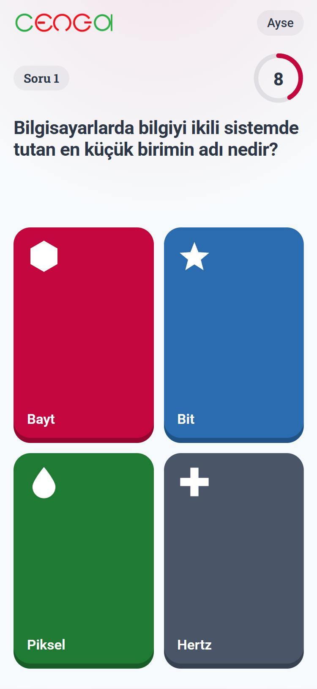 | 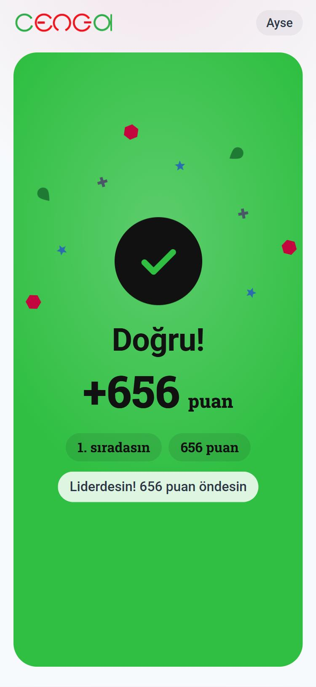 | 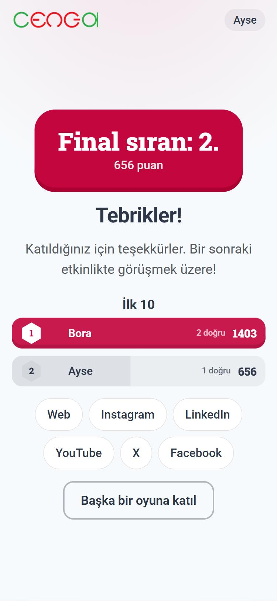 |

### Sunucu paneli: soru düzenleme

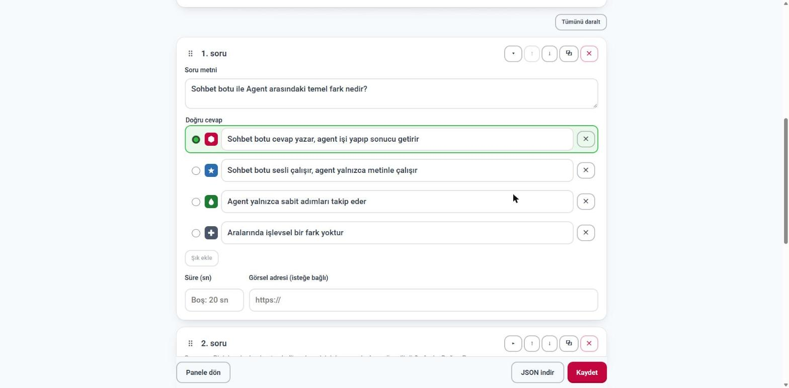

## Özellikler

- **Kurulumsuz katılım:** Oyuncular 6 haneli PIN ve takma adla tarayıcıdan katılır;
  hesap açmaz, uygulama indirmez.
- **Büyük ekran + telefon:** Sunum ekranında soru, geri sayım, cevap dağılımı,
  sıralama ve podyum; telefonda şık butonları ve kişisel sonuç.
- **QR ile katılım:** Lobide büyük bir QR kodu var; okutan oyuncu PIN yazmadan takma
  ad ekranına gelir.
- **Adil puanlama:** Puan sunucuda hesaplanır. "Hazır olun" sırasında sadece soru
  görünür, şıklar süre herkes için aynı anda başlayınca gelir. Hız puanı (en fazla
  1000) ve azalan adımlı seri bonusu (+40, +70, +90, +100).
- **Son sorularda 2× puan:** Son 3 soru (ayarlanabilir) çift puan değerindedir.
- **Heyecanlı sıralama:** Satırlar önceki yerinden kayarak gelir; yükselen/düşen
  okları, seri alevi, lider tacı ve "En çok yükselen". Telefonda "2 sıra yükseldin"
  ve "Önünde Ayşe var: 120 puan geridesin".
- **Ses ve müzik:** Kodla üretilen lobi müziği, son saniyelerde hızlanan geri sayım
  müziği, efektler ve podyum fanfarı (dosya ya da lisans gerekmez); müzik ve efekt
  ses düzeyi ayrı ayarlanır. Telefonlar doğru/yanlışta titreşir.
- **Sunucu kontrolü:** Süre bitmeden cevabı gösterme (onaylı), lobiyi kilitleme,
  oyuncu çıkarma.
- **Kulübe özel görünüm:** Ad, logo, renkler, fontlar, şık şekilleri ve final
  ekranı tek bir dosyada (`src/club.config.ts`).
- **Lobi güvenliği:** Takma ad filtresi, en fazla 300 oyuncu (ayarlanabilir).
- **Kopmaya dayanıklı:** Oyuncu ekranı kilitlerse ya da sunucu bilgisayarı
  bağlantıyı kaybederse oyun kaldığı yerden devam eder.
- **Quiz hazırlama:** Sorular panelden elle eklenip düzenlenir (şıklar, doğru cevap,
  süre, görsel; çoğaltma, sürükle-bırak sıralama). "1. Soru… A) … Doğru Cevap: B"
  biçimindeki metin yapıştırılınca sorular otomatik oluşur. JSON içe/dışa aktarma ve
  editör desteği için [JSON Schema](quizzes/quiz.schema.json) var.
- **Sunucu girişi:** E-posta + şifre; sadece izin listesindeki e-postalar kayıt
  olabilir ve e-posta doğrulaması zorunludur.
- **KVKK'ya uygun varsayılanlar:** Sadece takma ad, cevap ve puan saklanır; veriler
  AB'de (Belçika) tutulur ve sonuçlar belirli bir süre sonra otomatik silinir.
- **Düşük maliyet:** Kulüp ölçeğinde Firebase'in ücretsiz kotalarının altında kalır.

## Kendi kulübün için kur

### a) AI agent ile

Repoyu çatallayıp (fork) bir AI kodlama agent'ında açın ve şunu yapıştırın:

```text
Bu repoyu [Kulüp Adı] ([site]) için uyarla, AGENTS.md'yi takip et.
```

Agent kulübün sitesinden logo, renk ve fontları çıkarır, `src/club.config.ts`'i
doldurur, Firebase kurulumunu sizinle birlikte yapar, deploy eder ve örnek quizle
test eder. Adımlar [`AGENTS.md`](AGENTS.md) içinde.

### b) Elle kurulum

1. Repoyu çatallayın ve klonlayın. Node 22 gerekir.

   ```bash
   npm install && npm --prefix functions install
   ```

2. `src/club.config.ts` dosyasını kulübünüze göre doldurun; logo ve favicon'u
   `public/club/` altına koyun. Kulüp adı başka hiçbir dosyada geçmemeli.
3. Testleri çalıştırın:

   ```bash
   npm run test:unit
   npm run typecheck:all
   ```

4. Yerelde denemek için (Firebase hesabı gerekmez, Java 21+ gerekir):

   ```bash
   npm run dev:all
   ```

5. Gerçek Firebase projesine bağlayıp yayına almak için aşağıdaki bölüme bakın.

## Teknoloji yığını

| Katman | Kullanılan |
|---|---|
| İstemci | React 19, TypeScript, Vite 8, React Router 7; QR için `qrcode-generator` |
| Ses | Web Audio API (müzik ve efektler kodla üretilir) |
| Barındırma | Firebase Hosting |
| Kimlik | Firebase Authentication: oyuncular anonim, sunucular e-posta + şifre |
| Canlı oyun | Firebase Realtime Database (`europe-west1`) |
| Kalıcı veri | Cloud Firestore (quizler, sonuçlar; TTL ile otomatik silme) |
| Sunucu mantığı | Cloud Functions 2. nesil, Node 22 (`europe-west1`): `host` ve `checkHostEmail` callable'ları, RTDB tetikleyicileri, zamanlanmış temizlik |
| Güvenlik | Firestore ve RTDB Security Rules, App Check (reCAPTCHA Enterprise), kısıtlı API anahtarı |
| Test | Vitest + Testing Library (birim/bileşen), Firebase Emulator (kurallar ve Functions) |

Paylaşılan kod `shared/` altında: veri sözleşmesi (`types.ts`), puanlama ve quiz
doğrulama hem istemcide hem Cloud Functions'ta aynı dosyadan çalışır.

## Dağıtım (deployment)

Şu anki kurulum:

- **Firebase projesi:** `cenga-quiz`, Blaze planı; bütçe uyarıları açık.
- **Bölge:** Realtime Database, Firestore ve Cloud Functions `europe-west1` (Belçika).
- **Adres:** <https://cenga-quiz.web.app> (özel alan adı `quiz.cenga.org` planlanıyor).
- **Sürüm yayınlama:** elle, geliştiricinin bilgisayarından Firebase CLI ile:

  ```bash
  npm run test:unit && npm run typecheck:all
  npm run deploy             # web build + kurallar + Functions + Hosting
  npm run deploy:hosting     # yalnızca arayüz
  npm run deploy:functions   # yalnızca Cloud Functions
  ```

  Açık kalmış sayfalar yeni sürüm yayınlandığında bir sonraki ekran geçişinde
  kendini bir kez yeniler.

## Firebase kurulumu

Sistem Firebase üzerinde çalışır: Hosting, Authentication (E-posta/Şifre + Anonymous),
Firestore, Realtime Database ve Cloud Functions.

- **Blaze planı gereklidir.** Cloud Functions, zamanlanmış temizlik ve 100'den fazla
  eşzamanlı bağlantı Blaze ister. Blaze kullandıkça öde planıdır ama ücretsiz
  kotaları içerir.
- **Bütçe uyarısı kurun** (ör. 5 ve 20 dolar karşılığı). Uyarılar harcamayı
  durdurmaz, e-posta gönderir.
- **Beklenen maliyet:** Kulüp ölçeğinde (ayda birkaç etkinlik, oyun başına ~100-300
  kişi) pratikte **~0 $**. Kullanım ücretsiz kotaların altında kalır.

Adım adım kurulum: [`docs/firebase-kurulum.md`](docs/firebase-kurulum.md).
Etkinlik öncesi kontrol listesi (kota artışı, ağ testi, App Check):
[`docs/operasyon.md`](docs/operasyon.md).

Kısaca:

```bash
npm run configure -- firebase-config.txt   # konsoldaki firebaseConfig bloğu
npx firebase login
npm run deploy
```

## Quiz JSON formatı

```json
{
  "$schema": "./quiz.schema.json",
  "title": "Teknoloji ve Bilim Turu",
  "description": "İsteğe bağlı kısa açıklama",
  "questions": [
    {
      "text": "Suyun kimyasal formülü nedir?",
      "options": ["CO2", "H2O", "O2"],
      "correct": 1,
      "seconds": 15,
      "imageUrl": "https://ornek.org/gorsel.png"
    }
  ]
}
```

| Alan | Zorunlu | Kural |
|---|---|---|
| `title` | evet | 1-120 karakter |
| `description` | hayır | en fazla 500 karakter |
| `questions` | evet | 1-100 soru |
| `questions[].text` | evet | 1-300 karakter |
| `questions[].options` | evet | 2-4 farklı şık, her biri 1-120 karakter |
| `questions[].correct` | evet | doğru şıkkın 0'dan başlayan indeksi |
| `questions[].seconds` | hayır | 5-120 saniye (varsayılan: `club.config.ts`) |
| `questions[].imageUrl` | hayır | `https://` ile başlayan adres |

Tam tanım: [`quizzes/quiz.schema.json`](quizzes/quiz.schema.json). Örnek:
[`quizzes/ornek.json`](quizzes/ornek.json). Sunucu panelinde
**JSON'dan quiz içe aktar** ile yükleyin.

## Mimari

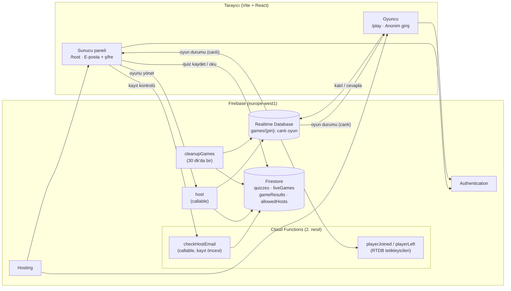

- **Firestore** kalıcı veriyi tutar: quizler, oyun anlık görüntüsü, sonuçlar (TTL ile
  otomatik silinir) ve sunucu izin listesi.
- **Realtime Database** sadece canlı oyun içindir. Doğru cevaplar oraya, cevap
  gösterilene kadar yazılmaz.
- **Cloud Functions** sunucu otoriterdir: puanlamayı, faz geçişlerini ve oyuncu
  isimlerinin temizlenmesini yapar.
- Erişim kuralları `rules/` altında; veri sözleşmesi `shared/types.ts` içinde.

## Katkı

Katkılar memnuniyetle karşılanır.

1. Bir issue açın ya da var olan birini seçin.
2. Değişikliği küçük tutun. Önce testini yazın, sonra kodu.
3. Göndermeden önce:

   ```bash
   npm run test:unit
   npm run typecheck:all
   npm test            # emulator testleri dahil, Java 21+ gerekir
   ```

4. Commit mesajları Türkçe ve [conventional](https://www.conventionalcommits.org/)
   formatta olsun (ör. `fix(lobi): ...`).
5. Kulübe özel değişiklikler (`src/club.config.ts`, `public/club/`) ana repoya
   değil, kendi çatalınıza aittir.

## Lisans

[MIT](LICENSE)

---

[CENGA](https://www.cenga.org) tarafından geliştirildi.

## English

A live quiz system for university clubs: players join from their phones with a
6-digit PIN and a nickname, while the host runs the game on a big screen. It runs
on your own Firebase project (Hosting, Auth, Firestore, Realtime Database, Cloud
Functions). At club scale it stays within the free quotas, so the cost is about $0.

- **Set it up with an AI agent:** fork the repo and ask your coding agent:
  `Adapt this repo for [Club Name] ([website]), follow AGENTS.md.`
- **Live:** <https://cenga-quiz.web.app>. Stack: React 19 + TypeScript + Vite on
  Firebase (Hosting, Auth, Realtime Database, Firestore, Cloud Functions in
  europe-west1); screenshots above.
- **Manual setup:** fill in `src/club.config.ts`, put your logo in `public/club/`,
  then follow [`docs/firebase-kurulum.md`](docs/firebase-kurulum.md) (Turkish).
- **Quiz format:** see [`quizzes/quiz.schema.json`](quizzes/quiz.schema.json).
- **License:** MIT. Built by [CENGA](https://www.cenga.org).
